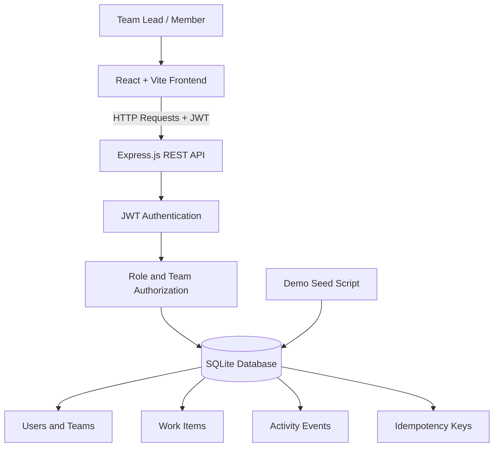

# OpsFlow Architecture

## Components

- Frontend: React and Vite provide the user interface.
- Backend: Express.js exposes REST API endpoints.
- Authentication: JWT identifies the current user.
- Authorization: The backend checks roles and team permissions.
- Database: SQLite stores users, teams, work items, activity events, and idempotency records.
- Demo setup: backend/seed.js creates demo teams and accounts.

## Architecture Diagram

## Important Design Choices

- Authorization is enforced by the backend.
- Database transactions help keep work-item changes and activity history consistent.
- Version numbers help detect stale updates.
- Idempotency keys help prevent duplicate work-item creation during retries.
